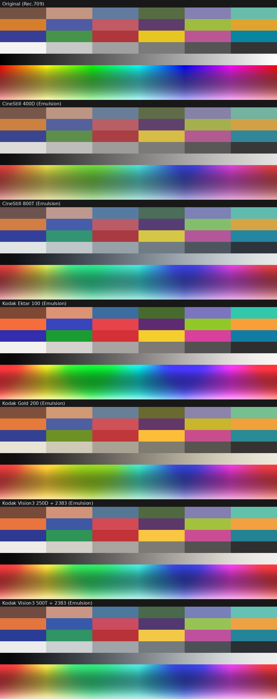

# Emulsion

Film-stock LUTs for DaVinci Resolve, organized by brand, film type and style, with human-readable names.

- **353 LUTs**: the full RawTherapee Film Simulation collection converted from HaldCLUT to `.cube`, plus 6 original film-inspired LUTs built from scratch for stocks the collection is missing.
- **Organized library**: one folder per brand, split into Color Negative, Slide, Black & White, Motion Picture and Instant; creative looks grouped by style; strength variants tucked into `Variations` subfolders.
- **00 Recommended**: 11 general-purpose picks that hold up on most Rec.709 footage.
- **Tools** to rebuild everything yourself: HaldCLUT → `.cube` converter, the film LUT generator, the library organizer and a test-sheet renderer.

## Download

Grab **`Emulsion-LUT-Library-v1.0.zip`** from the [Releases](../../releases) page. It contains the whole organized library.

The 6 original LUTs are also in [`luts/`](luts/) if you only want those.

## Install (DaVinci Resolve)

1. Extract the `Emulsion` folder into Resolve's LUT folder:
   - Windows: `C:\ProgramData\Blackmagic Design\DaVinci Resolve\Support\LUT`
   - macOS: `/Library/Application Support/Blackmagic Design/DaVinci Resolve/LUT`
   - Linux: `/opt/resolve/LUT`
2. In Resolve: **Project Settings → Color Management → Lookup Tables → Update Lists** (or restart).
3. On the Color page, open the **LUTs** browser (top-left), enable **Live Preview** in its options menu, select a node and hover over thumbnails to preview. Drag a LUT onto a node to apply it. Star the ones you like to add them to Favorites.

## Input color space

All LUTs expect **regular Rec.709 / gamma 2.4 video (not log)**, with one exception:

> ⚠️ `09 Print Film (LOG input)` — Kodak 2383/2393 and Fuji 3510/3513 print emulations expect **Cineon log** input. On Rec.709 footage they look washed out.

If your project uses DaVinci Wide Gamut / Resolve Color Management, add a **Color Space Transform** node to Rec.709 / Gamma 2.4 before the LUT node.

## Suggested node tree

```
[01 Balance] → [02 Film LUT] → [03 Film Look Creator: texture only]
```

1. **Balance**: exposure and white balance first. Film LUTs react strongly to input exposure.
2. **Film LUT**: drop the LUT on its own node. Lower **Key Output Gain** (Key palette) to reduce its strength.
3. **Film Look Creator** (Resolve Studio): start from the **Clean Slate** preset, or set *Film Look Blend* and *Color Blend* to 0 and *Effects Blend* to 100%. Use it only for halation, bloom and grain. Keep grain on the last node.

Save combinations you like as **PowerGrades** in the Gallery to reuse them in one click.

## Library structure

```
Emulsion/
├─ 00 Recommended
├─ 01 Kodak              Color Negative · Slide · Black & White · Motion Picture
├─ 02 Fujifilm           Color Negative · Slide · Black & White · Instant
├─ 03 CineStill          800T · 400D
├─ 04 Ilford
├─ 05 Agfa
├─ 06 Polaroid           Color · Black & White
├─ 07 Rollei & Lomography
├─ 08 Creative           Warm & Golden · Vintage & Faded · Vibrant & Contrast · Monochrome · Experimental
└─ 09 Print Film (LOG input)
```

Naming conventions:

| Suffix | Meaning |
|---|---|
| `+1`, `+2`, `+3` | Stronger version of the same stock (in `Variations/`) |
| `-1`, `-2`, `-3` | Softer version of the same stock (in `Variations/`) |
| `(alt)` | A second version of the same stock from another part of the original collection |
| `(Generic)` | Generic approximation from the original collection |
| `(Emulsion)` | Original LUT built from scratch for this project |

### 00 Recommended

| Use | LUT |
|---|---|
| Day | Kodak Portra 400, Kodak Portra 160, Kodak Gold 200, Fuji 400H, CineStill 400D, Fuji Superia 400 |
| Cinema | Kodak Vision3 250D + 2383 |
| Night | CineStill 800T, Kodak Portra 800 |
| B&W | Ilford HP5 Plus 400, Kodak Tri-X 400 |

## The original Emulsion LUTs

The RawTherapee collection has no Kodak Gold 200, Ektar 100, CineStill or Vision3 stocks, so these were built from scratch with [`tools/film_luts.py`](tools/film_luts.py):

| LUT | Character |
|---|---|
| Kodak Gold 200 | Warm, golden, olive greens, pastel skies; lab-scan look |
| Kodak Ektar 100 | High saturation, deep blues, warm reds, dense blacks |
| CineStill 800T | Tungsten balance: cool/cyan in neutral light, warm practicals, lifted blacks |
| Kodak Vision3 500T + 2383 | Tungsten with 2383 print: dense blacks, teal shadows, warm skin |
| CineStill 400D | Neutral daylight, low contrast, wide latitude, restrained saturation |
| Kodak Vision3 250D + 2383 | Daylight with 2383 print: cinema contrast, rich reds and yellows |



**How they're made.** Each LUT is a small physical-ish model: Rec.709 is decoded to linear light, a per-channel balance is applied (e.g. tungsten), then a per-channel characteristic curve in log space (toe, straight line, shoulder) with slightly different contrast per channel to create natural color crossovers. Finally, saturation by luminance and localized hue shifts are applied in Oklab, followed by smooth gamut compression instead of hard clipping.

**What they are not.** These are *inspired by* the stocks, based on their published characteristic curves and well-known traits. They are not measured emulations from real film scans. Halation, grain and bloom are spatial effects and are not part of any LUT; add them with Film Look Creator.

**Validation.** Every LUT is checked for a monotonic gray ramp (no tonal inversions), no NaNs, and smoothness. All 6 are smoother than the converted collection LUTs (max second difference ≈ 0.02–0.08 vs ≈ 0.17).

## Rebuild from source

```bash
pip install -r requirements.txt

# 1. Get the original HaldCLUT collection
git clone https://github.com/cyangraphics/clut

# 2. Convert HaldCLUTs to .cube (33 points; use --size 65 for more precision)
python tools/hald2cube.py clut build/rawtherapee --size 33

# 3. Generate the original Emulsion LUTs
python tools/film_luts.py build/originals

# 4. Build the organized library
python tools/organize.py build/rawtherapee build/originals build/Emulsion

# Optional: render a comparison sheet for any folder of .cube files
python tools/test_sheet.py build/originals test-sheet.png
```

To tweak an original LUT, edit its parameters in the `STOCKS` list in `tools/film_luts.py` and run step 3 again.

## Credits & license

- **Converted LUTs**: derived from the [RawTherapee Film Simulation collection](https://rawpedia.rawtherapee.com/Film_Simulation) ([mirror](https://github.com/cyangraphics/clut)) by **Pat David**, **Marc Roovers** (PictureFX) and **Juan Melara** (print films), licensed under [CC BY-SA 4.0](https://creativecommons.org/licenses/by-sa/4.0/). The converted and reorganized versions are distributed under the same license.
- **Original Emulsion LUTs** (`luts/`): [CC BY-SA 4.0](LICENSE-LUTS.md).
- **Code** (`tools/`): [MIT](LICENSE).

Trademarked film names are used only to describe which stock a LUT is designed to approximate. This project is not affiliated with or endorsed by Kodak, Fujifilm, CineStill, Ilford, Agfa, Polaroid, Rollei, Lomography or Blackmagic Design.
